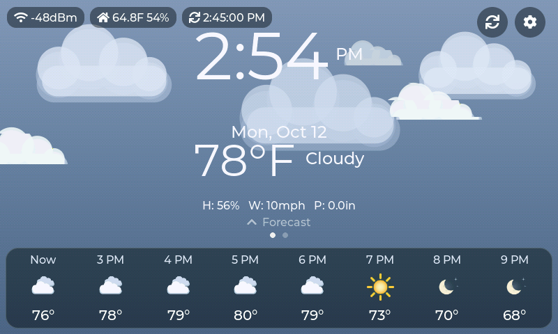

# SmartClockOS

A wall clock with live weather for the Sunton **ESP32-8048S070** (7" 800x480 touch screen, ESP32-S3). It is an Arduino sketch built on LVGL 9.

Current version: **2.8.0**



## What it does

- **Clock and weather on one screen.** Large time and date, current temperature and conditions, and a strip of the next 24 hours.
- **Animated sky.** The background and its sun, moon, stars, clouds, rain, snow, fog and lightning follow the real weather. Clouds drift faster when it is windy.
- **Forecast page.** Swipe to see sunrise and sunset, a 24-hour temperature and rain chart, and a 7-day forecast.
- **Indoor readings** from an optional BME280 sensor.
- **Night mode.** Dims the screen between the hours you choose.
- **Settings on the touch screen:** brightness, night mode, and units (°F/°C, mph/km/h, in/mm).
- **Web page on your home network:** change settings and WiFi, see diagnostics and logs, and upload new firmware. `/api/screenshot` returns a picture of the display.
- **Optional cooling fan** control. It does nothing if no fan is wired. This part has not been tested with a real fan yet.

Weather comes from [Open-Meteo](https://open-meteo.com/), which needs no account or key. It refreshes every 10 minutes. Time comes from the internet (NTP).

## Hardware

- Sunton ESP32-8048S070 (ESP32-S3, 8 MB PSRAM, GT911 touch)
- Optional: BME280 sensor. Wiring is in [hardware-docs/BME280_wiring.md](hardware-docs/BME280_wiring.md).
- Optional: 30 mm 5 V fan with a MOSFET switch. See [case/FAN.md](case/FAN.md).

Pin numbers and board notes are in [hardware-docs](hardware-docs/README.md).

## Build and flash

You need the Arduino IDE or `arduino-cli`, with the **esp32** board package (3.3.x) and these libraries:

| Library | Version used |
| --- | --- |
| lvgl | 9.5.0 |
| GFX Library for Arduino | 1.6.7 |
| TAMC_GT911 | 1.0.2 |
| ArduinoJson | 7.4.3 |
| Adafruit BME280 Library | 2.3.0 |

Steps:

1. Download this repo into a folder named `SmartClockOS`.
2. Copy `extras/lv_conf.h` into your Arduino `libraries` folder, next to the `lvgl` folder. The clock needs these LVGL settings.
3. Copy `Secrets.example.h` to `Secrets.h` and fill in your WiFi name, WiFi password and location.
4. Set your time zone in `Config.h` (`TIMEZONE`). It is set to US Eastern.
5. Build and upload. In the Arduino IDE choose board **ESP32S3 Dev Module**, PSRAM **OPI PSRAM**, and partition scheme **No FS 4MB (2MB APP x2)**. With `arduino-cli` those settings come from `sketch.yaml`:

   ```bash
   arduino-cli compile .
   ```

   ```bash
   arduino-cli upload -p YOUR_PORT .
   ```

After the first upload you can update over WiFi: open the clock's web page and use **Firmware Update**.

## The web page

Open the clock's address in a browser. The address is shown at the bottom of the clock's settings screen.

The web page has no login. Anyone on the same network can change settings or upload firmware, so only use it on a network you trust.

## Case

[case](case/README.md) has a 3D-printable wall case: the OpenSCAD source, STL files, renders and assembly notes.
